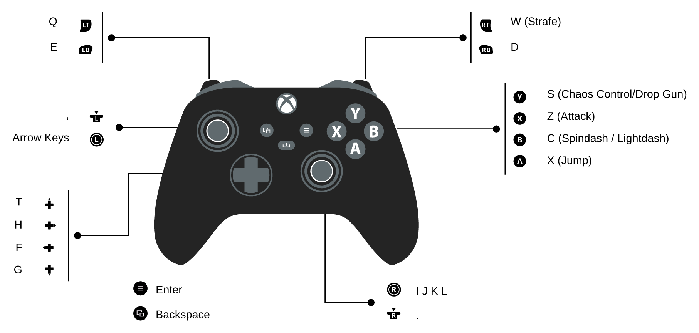

    <b>F O X ■ W O R K S H O P ■ P R E S E N T S</b>

    

<h3 align="center">
    Shadow '05 for the OG Xbox, now on PC. 
    20 Months in the Making
</h3>

    <a href="https://github.com/FoxWorkshop/ShadowRecomp/releases/latest"><b>Download</b></a>
    ·
    <a href="#installation"><b>Install</b></a>
    ·
    <a href="#faq"><b>FAQ</b></a>
    ·
    <a href="/docs/BUILDING.md"><b>Building</b></a>
    ·
    <a href="https://github.com/FoxWorkshop/ShadowRecomp/issues"><b>Issues</b></a>
    ·
    <a href="#credits"><b>Credits</b></a>

---

## Features

**Setup**

- Built-in installer
- Verifies your game files

**Display**

- Any aspect: 16:9, 16:10 and ultrawide (21:9+)
- Adjustable UI alignment
- Bloom intensity slider (optional)
- High framerate (optional)
- Unlocked cutscene framerate (optional)

**Menus**

- Custom options menu
- Full controller navigation
- Skip any cutscene

**Achievements**

- View from pause menu
- Local only

**Mods**

- Works with [SA Mod Manager]
- Uses the Sonic Adventure mod format
- Code mods: not yet
- Some code mods built in: see Mod Manager's Codes tab

## Controls

Default keyboard controls:

- Loosely based on Dolphin Emulator's default keyboard layout
    - Adapted to the Xbox controller
- Remap them in the in-game options, or in `config.toml`

| Hotkey    | Action                          |
| --------- | ------------------------------- |
| Alt+Enter | Toggle fullscreen/windowed mode |
| Ctrl+1    | Keyboard controls port 1        |
| Ctrl+2    | Keyboard controls port 2        |
| Ctrl+3    | Keyboard controls port 3        |
| Ctrl+4    | Keyboard controls port 4        |
| F1        | Toggle profiler                 |
| F8        | Toggle HUD                      |

## Fixes

### Xbox-only Bugs Fixed

- Subtitles too faint after a Restart/Quit prompt
- White flash on environment/destructible object fade in
- Audio distance and looping bugs
    - e.g. Goal Ring going 0% to 100% on volume instead of proper proximity
- Player 2 not controlling the partner
- Egg Dealer missing looping noise

### Visuals

- Bloom:
    - Now covers the whole screen
    - No artifacts along the bottom edge
    - No dark bands or boxes blending over the screen

- Transparency issues:
    - Vertical Elevators (Lost Impact, The Doom)

- Egg Dealer roulette flashing white

- AirSaucer Effect Speed Multiplying by Number of Saucers

- Artifacts on screen edges

- Animated textures sometimes not animating

- Objects with fade-in disappearing for a frame

- Drop shadows vanishing during laser lock-on
    - e.g. 4SHOT, 8SHOT, Satellite Laser

- Shadow's shoes
    - Finally, after 21 years they have 4 jet flames instead of 3

### Gameplay

- A LOT of High framerate glitches
- Space Gadget gravity
    - Slide & Spin Dash controls properly in all gravity modes (no more inverted controls)
    - No flipping 180 after landing upside down
- Lethal Highway rail that can kill the player
- Rails applying velocity on detach incorrectly
- Sound effects cutting off in busy areas (e.g. in Glyphic Canyon / Sky Troops)
- Fixed Black Hawk softlock at end of some paths (e.g. Cryptic Castle)
- Black Tank invincible while waiting for the player
    - It's meant to give struggling players a chance to hit it
- Ball Switches ignoring melee hits
    - Now react to melee instead of draining your ammo

## FAQ

### Do you have a website?

Shadow Recompiled does not have an official website.

Link people to this GitHub page.

> [!CAUTION]
> **Only download from our [Releases] page.**
> We never share builds on other sites, Discord or third-party updaters.

### Can I install using GameCube / PlayStation 2 version?

**No**. Would require separate recomps.

### Where are save data & configs?

- Windows: `%APPDATA%\ShadowRecomp\`
- Linux: `~/.config/ShadowRecomp/`

Inside, saves are in `save/` and settings in `config.toml`.

You can also create `portable.txt` beside the `.exe` to keep everything in
your game folder.

### How do I update?

Copy the files from a new [release][all releases] over your existing install.

- Saves and settings are kept
- Reinstall not needed afterwards. Just boot the game

### How do I run the installer again?

Launch the game with `--install`.
In a console/terminal window.

You'll only need this if you changed the game files; and
want to revert to a stock setup.

### Why does some of the UI have visible lines or gaps?

This is a vanilla game issue.
Higher resolutions unfortunately make this issue easier to see.

- Please don't open an issue for it.
- To fix it, use HD GUI mod(s).

### Why are some sound effects missing

The Xbox version of the game has several missing sound effects.
See [details here][issue 44] if interested.

You will need to use a SFX Restoration mod to fix these defects.

### What other platforms will be supported?

We only have Windows + Linux machines.  
We'd happily accept community contribution for macOS.  

But folks who want to support platforms that require more significant modifications 
(e.g. touchscreen on mobile); should make a fork.

## Known Issues

Before reporting any issues, check if they are listed [here][issues].

## Building

[Check out the building instructions here][BUILDING.md].

## Credits

### Shadow Recompiled

**Programming**
- [Sora]
    - Creator and lead dev
    - Built tech like [XShaderRecomp] and OG [XboxRecomp]
    - The reason this project exists
- [dreamsyntax]
    - Shadow expert: kept the port accurate and found flaws in the Xbox port
    - A huge amount of game patches
- [Sewer56]
    - Helped Sora understand recompilation
    - Improved framepacing, widescreen base, Discord RPC, Nix support. etc
    - [XboxRecomp2] recompiler
    - Months of performance work. >4x FPS gain
- [DonutStopGaming]: help with RenderWare and finding Shadow functions

**Design & Art**
- [Sora]: final design and UI for the installer, achievements and custom menus
- [TheHatedGravity]: first installer design, UI polish, spotting visual flaws
- [Deep-Sea Berry]: project logo and options icons

**Music**
- [Kondrashov's Lair]: installer music (original by Sins Of A Divine Mother)

**Translation** (custom menus)
- English: [dreamsyntax]
- French: [Sora]
- German: [Deep-Sea Berry]
- Italian: [Emasplatter]
- Japanese: [Windii]
- Spanish: [Jesus_PK]

### Tester Thanks
- [Jesus_PK]
- [Deep-Sea Berry]
- [Rawlins]
- [DarkShadow17]
- [The Spectral Star]
- [Pixel The Retro]
- [ultra0000]
- Many others who helped briefly test

### Special Thanks

**Projects**

- [CXBX-Reloaded] team: their research on the HLE Emulation of the OG Xbox
  was the base for nearly every part of this project, *especially* graphics

- [Unleashed Recompiled] team: laid much of the groundwork and sped up development a lot

- [Marathon Recompiled]: reference for features and debugging

- [extract-xiso]: game file extraction in the installer
    - By in@fishtank.com and other contributors

**People**

- [Skyth]: helped Sora understand recompilation
    - Wrote the original graphics pipeline, mostly reused here
- [Darío]: created [plume], the graphics layer under our renderer
- [MattKC]: explained the Xbox push buffer system on [his Reburn3 blog][Reburn3 blog]
- [ocornut]: created Dear ImGui, the base of our custom menus

[SA Mod Manager]: https://github.com/X-Hax/SA-Mod-Manager
[Releases]: https://github.com/FoxWorkshop/ShadowRecomp/releases/latest
[issues]: https://github.com/FoxWorkshop/ShadowRecomp/issues
[all releases]: https://github.com/FoxWorkshop/ShadowRecomp/releases
[issue 44]: https://github.com/FoxWorkshop/ShadowRecomp/issues/44
[BUILDING.md]: /docs/BUILDING.md
[Sora]: https://github.com/Sora-yx
[XboxRecomp]: https://github.com/FoxWorkshop/XboxRecomp
[XboxRecomp2]: https://sewer56.dev/XboxRecomp2
[XShaderRecomp]: https://github.com/FoxWorkshop/XShaderRecomp
[dreamsyntax]: https://github.com/dreamsyntax
[Sewer56]: https://github.com/Sewer56
[TheHatedGravity]: https://github.com/TheHatedGravity
[DonutStopGaming]: https://github.com/DonutStopGaming
[Jesus_PK]: https://github.com/Jesus-PK
[Deep-Sea Berry]: https://github.com/Deep-SeaBerry
[Emasplatter]: https://twitter.com/emasplatter
[Windii]: https://www.youtube.com/@WindiiGitlord/videos
[Kondrashov's Lair]: https://www.youtube.com/channel/UCUU-r-7kVY3ig-GY7KTFvlw
[ultra0000]: https://github.com/ultra0000
[Rawlins]: https://www.youtube.com/channel/UCjbUqRzVay-6HjoJjODre5w
[DarkShadow17]: https://www.youtube.com/@DarkShadowtH
[The Spectral Star]: https://www.youtube.com/@the-spectral-star5086
[CXBX-Reloaded]: https://github.com/Cxbx-Reloaded/Cxbx-Reloaded-legacy
[extract-xiso]: https://github.com/XboxDev/extract-xiso
[Marathon Recompiled]: https://github.com/sonicnext-dev/MarathonRecomp
[Skyth]: https://github.com/blueskythlikesclouds
[Darío]: https://github.com/DarioSamo
[plume]: https://github.com/renderbag/plume
[MattKC]: https://github.com/itsmattkc
[Reburn3 blog]: https://forum.mattkc.com/viewtopic.php?t=154
[ocornut]: https://github.com/ocornut
[Pixel The Retro]: https://x.com/PixelTheRetro
[Unleashed Recompiled]: https://github.com/hedge-dev/UnleashedRecomp